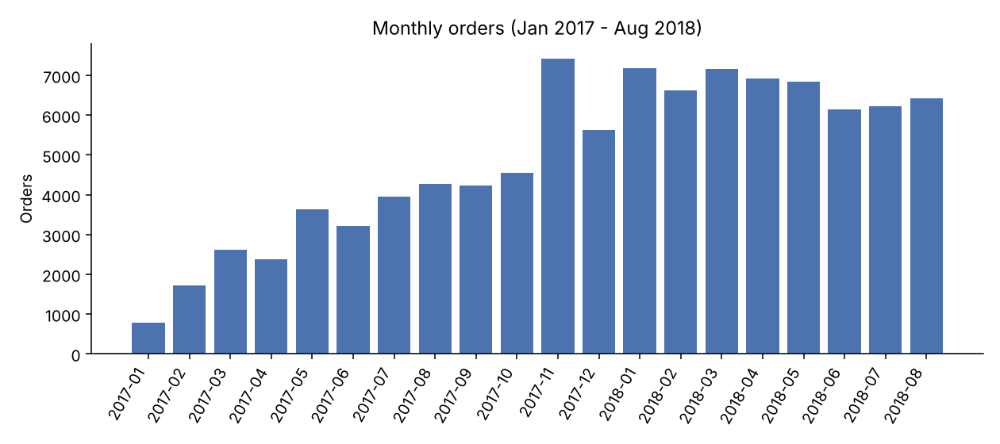
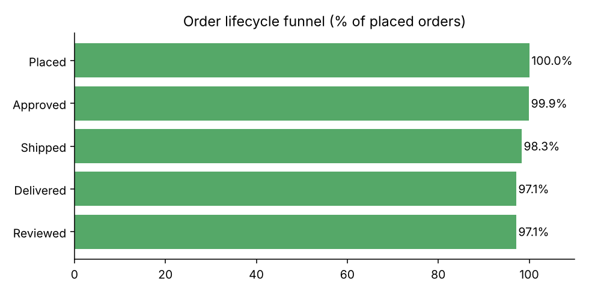
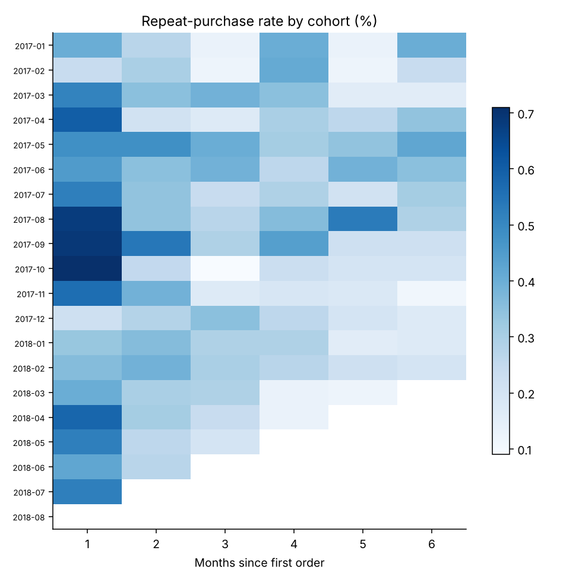
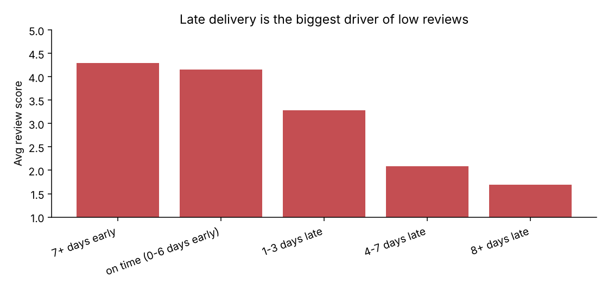

# Olist E-commerce Product Analytics

SQL + Python analysis of ~100k real orders from Olist, a Brazilian e-commerce marketplace (2017-2018). It covers growth KPIs, the order lifecycle funnel, cohort retention, anomaly detection and a root-cause analysis of what drives bad customer reviews.

**Stack:** SQL (DuckDB), Python, pandas, matplotlib

## Key findings

| Question | Finding |
|---|---|
| How fast did it grow? | Monthly orders grew from 787 (Jan 2017) to ~6,100-7,200/month in 2018. Black Friday 2017 drove the peak: 7,423 orders in Nov 2017 (+63% MoM). |
| Any anomalies? | 24 Nov 2017 (Black Friday) hit 1,176 orders vs a trailing 28-day mean of ~170 (z = 23.6). 21 Jun 2017 dipped to 35 orders vs ~114 expected, worth checking for a tracking or fulfilment outage. |
| Where does the funnel leak? | 97.1% of placed orders are delivered; the biggest step loss is approved to shipped (98.4% pass), followed by shipped to delivered (98.8%). |
| Do customers come back? | Only 3.0% of 94,707 customers placed a second order. Repeat purchase is the main growth lever. |
| What drives bad reviews? | Late delivery. Orders arriving 8+ days past the promised date average 1.69 stars (79% give 1-2 stars) vs 4.30 for early deliveries. Just 6.8% of delivered orders are late, yet they produce 32.5% of all 1-2 star reviews. |
| Where is delivery weakest? | Northeast states (AL 21.5% late, MA 17.5%, SE 15.4%) vs 12.1% in RJ. |

**Recommendation:** Fix delivery promises in the northeast first (pad estimates or shift inventory closer), and use a post-delivery nudge to lift repeat purchases. Hitting the promised date matters more for reviews than shipping speed does.

## Charts






## Repo layout

```
sql/        00_setup.sql (views) + 01-06 analysis queries
src/        analysis.py runs every query and builds the charts
outputs/    result CSVs and PNG charts
data/       place the Olist CSVs here (not committed)
```

## Run it

1. Download the [Olist Brazilian E-Commerce dataset](https://www.kaggle.com/datasets/olistbr/brazilian-ecommerce) (CC BY-NC-SA 4.0) and put these files in `data/`:
   `olist_orders_dataset.csv`, `olist_order_items_dataset.csv`, `olist_order_payments_dataset.csv`, `olist_order_reviews_dataset.csv`, `olist_customers_dataset.csv`, `olist_products_dataset.csv`
2. Install and run:

```bash
pip install -r requirements.txt
python src/analysis.py
```

## Method notes

- Analysis window is Jan 2017 - Aug 2018 (full months only; 2016 and Sep-Oct 2018 are sparse).
- Customers are identified by `customer_unique_id`, since `customer_id` changes per order.
- Cancelled and unavailable orders are excluded from GMV and retention.
- Anomalies use a trailing 28-day mean and standard deviation, flagging |z| > 3. Early-2017 flags reflect a small base.
- Review score is averaged per order when an order has multiple reviews.
